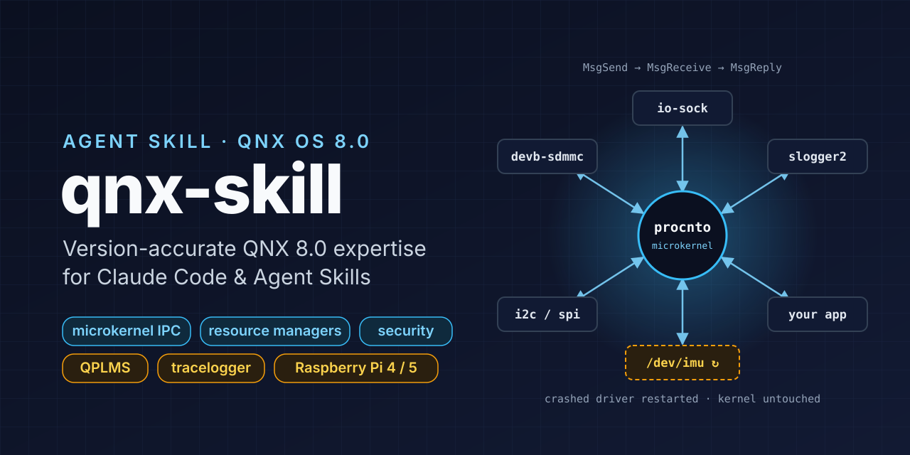
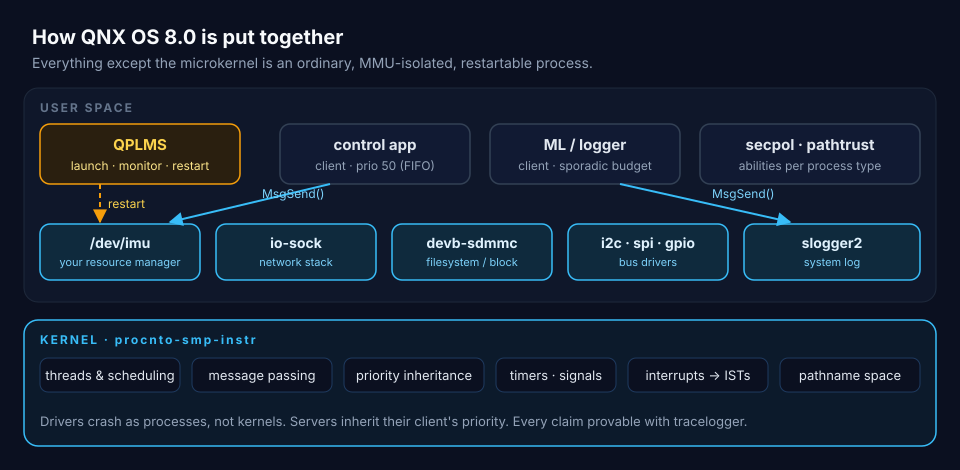

<p align="center">
  
</p>

<p align="center">
  <a href="LICENSE"></a>
  
  
  
</p>

# qnx-skill

A [Claude Code](https://claude.com/claude-code) / Agent Skill that makes Claude a careful, **version-accurate QNX OS 8.0** engineer.

Most QNX material online — and most of what LLMs remember — describes QNX 6.x/7.x. QNX SDP 8.0 removed or replaced a lot of it (APS, Qnet, PPS, io-pkt, ISRs, `/dev/mem`, HAM → QPLMS, …). This skill gives Claude the 8.0 picture, a "traps" table to check before answering, working code patterns, and a habit of verifying against the official 8.0 docs instead of guessing.

<p align="center">
  
</p>

## Why it exists

Ask a general-purpose model to "use adaptive partitioning to cap this process" or "talk to the other Pi over Qnet" on QNX 8.0 and it will confidently write code that can't work — both features were discontinued. This skill fixes that class of mistake:

- **8.0 traps table** — the removed/replaced features (APS, Qnet, PPS, io-pkt, ISRs, `/dev/mem`, syslogd, HAM, sandboxing, `secpol -p`, …) with their replacements, checked before answering.
- **Working patterns** — name_attach servers, pulses and timers, a resource-manager skeleton with read/write/devctl handlers, QPLMS configs, CMake toolchain files.
- **Honesty rules** — a QNX-vs-Linux comparison so claims to QNX experts (or hackathon judges) hold up.
- **Verification habit** — documented URL patterns for the official 8.0 docs, `use <utility>` on target, and *(unverified)* markers where docs couldn't be confirmed.

## Example prompts

- "Set up QNX on my Raspberry Pi 4 headless over Wi-Fi and get SSH working."
- "Write a resource manager that exposes my I2C IMU as `/dev/imu` with a devctl to set the sample rate."
- "My control loop misses deadlines when the logger is busy — how do I prove and fix it with tracelogger?"
- "How do I restrict a third-party process on QNX 8.0 now that APS is gone?"
- "Make my app's binaries the only ones allowed to execute (pathtrust + QTD)."
- "Configure the QNX Toolkit for VS Code to build and debug on the Pi."

## What it covers

| Area | Reference |
|---|---|
| Microkernel architecture, message passing, priority inheritance, scheduling (FIFO/RR/sporadic), runmasks/clusters, interrupts (ISTs), timers, memory, boot | `skills/qnx/references/architecture.md` |
| Everything discontinued/deprecated in 8.0 and the replacements | `skills/qnx/references/qnx8-changes.md` |
| Server/client IPC, pulses, events, channel flags, resource-manager skeleton, read/write/devctl handlers | `skills/qnx/references/ipc-and-resource-managers.md` |
| Abilities, security policies (secpol), pathtrust, QNX Trusted Disk (QTD/mkqfs), ASLR, rlimits | `skills/qnx/references/security.md` |
| QPLMS process launch/monitoring (HAM replacement) | `skills/qnx/references/qplms.md` |
| tracelogger, System Profiler, slog2, pidin, debugging | `skills/qnx/references/tracing-and-debugging.md` |
| SDP install, qcc/q++, CMake toolchain, ports (OpenCV, TFLite, ROS 2), mkifs/mkqnximage, deploying | `skills/qnx/references/toolchain-and-build.md` |
| QNX Toolkit for VS Code (build/run/debug/profile) | `skills/qnx/references/vscode-toolkit.md` |
| Raspberry Pi 4/5 with the QNX Everywhere quick start image: flashing, Wi-Fi, SSH, serial, BSP drivers | `skills/qnx/references/rpi-setup.md` |
| Honest QNX-vs-Linux comparison (what's genuinely unique, what isn't) | `skills/qnx/references/linux-comparison.md` |

Helper scripts:
- `skills/qnx/scripts/check-host.sh [SDP_DIR] [user@target]` — checks the host SDP install (env script, `qcc`, aarch64 target, license) and optionally SSH to a target.
- `skills/qnx/scripts/deploy-run.sh <file.c|file.cpp|binary> [user@host] [-- args]` — cross-compiles for aarch64le, copies to the target, runs it.

## Install

**As a plugin (Claude Code):**
```
/plugin marketplace add CalicoNino/qnx-skill
/plugin install qnx@qnx-skill
```

**As a personal skill (any Agent-Skills-compatible client):**
```bash
git clone https://github.com/CalicoNino/qnx-skill.git
ln -s "$PWD/qnx-skill/skills/qnx" ~/.claude/skills/qnx
```
Or copy `skills/qnx/` into a project's `.claude/skills/`.

The skill triggers automatically when you mention QNX, Neutrino, procnto, resource managers, qcc, QNX Everywhere, the Pi quick start image, the VS Code toolkit, etc. You can also invoke it with `/qnx`.

## Accuracy notes

- Written against **QNX SDP 8.0** docs as published in November 2026. Items that couldn't be confirmed in the 8.0 docs are marked *(unverified)* in the references, and the skill tells Claude to fetch the official page before relying on them.
- QNX 8.0 point releases keep changing details — corrections are welcome (open an issue or PR, ideally with the qnx.com doc URL).

## Disclaimer

Not affiliated with, endorsed by, or supported by QNX Software Systems or BlackBerry. QNX, Neutrino, Momentics and related marks are trademarks of BlackBerry Limited. This repository contains original summaries and examples; consult the [official QNX documentation](https://www.qnx.com/developers/docs/8.0/) for authoritative information. QNX SDP itself requires a license from QNX (a free non-commercial license is available through QNX Everywhere).

## License

MIT — see [LICENSE](LICENSE).
